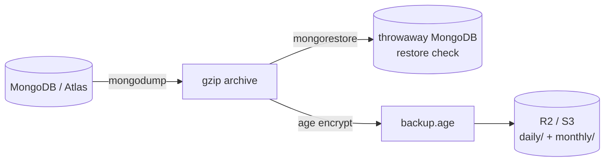

# atlas-r2-backup

A GitHub Action that backs up a MongoDB database every night: it dumps the database, **restores the dump
into a throwaway MongoDB to prove it works**, encrypts it with [age](https://age-encryption.org) and uploads
it to Cloudflare R2 or any S3-compatible bucket.

Built for MongoDB Atlas free and shared tiers, which have no automated backups of their own, and for anyone
who wants an off-site, encrypted copy they control.



## Why this design

- **A backup is only as good as its restore.** Every run restores the dump into a fresh MongoDB container
  and fails if no documents come back, so a broken backup is noticed the night it happens, not on the day you
  need it.
- **The storage never sees your data.** Backups are encrypted on the runner with your age *public* key.
  The private key stays offline with you; GitHub and the bucket only hold ciphertext.
- **Retention without scripts.** Each run writes `daily/<date>`; the first run of each month also writes
  `monthly/<month>`. Bucket lifecycle rules delete old objects (e.g. daily after 30 days, monthly after a year).
- **Least privilege.** A read-only database user and a storage token limited to one bucket.
- **Pinned, verified tools.** MongoDB Database Tools and age are installed at fixed versions and checked
  against SHA-256 sums.

## Usage

```yaml
# .github/workflows/backup.yml
name: Database backup
on:
  schedule:
    - cron: '30 7 * * *'
  workflow_dispatch:

permissions:
  contents: read

jobs:
  backup:
    runs-on: ubuntu-24.04
    timeout-minutes: 20
    steps:
      - uses: bluedragonteam/atlas-r2-backup@v1
        with:
          mongodb-uri: ${{ secrets.MONGODB_BACKUP_URI }}
          age-recipients: ${{ secrets.BACKUP_AGE_RECIPIENTS }}
          r2-account-id: ${{ secrets.CLOUDFLARE_ACCOUNT_ID }}
          bucket: my-db-backups
          access-key-id: ${{ secrets.R2_ACCESS_KEY_ID }}
          secret-access-key: ${{ secrets.R2_SECRET_ACCESS_KEY }}
```

For other S3-compatible storage (AWS S3, Backblaze B2, MinIO, Garage …) set `endpoint` instead of `r2-account-id`.

### Inputs

| Input | Required | Default | |
|---|---|---|---|
| `mongodb-uri` | yes | | Read-only user, with the database name in the path (`…/mydb?…`) |
| `age-recipients` | yes | | One or more age public keys, separated by spaces, commas or new lines |
| `bucket` | yes | | Bucket name |
| `access-key-id`, `secret-access-key` | yes | | S3 credentials limited to the bucket |
| `r2-account-id` | one of | | Cloudflare account ID (builds the R2 endpoint) |
| `endpoint` | one of | | Any other S3 endpoint |
| `prefix` | no | `''` | Key prefix, e.g. `prod/` |
| `monthly-copy` | no | `true` | Keep the first backup of each month under `monthly/` |
| `verify-restore` | no | `true` | Restore into a throwaway MongoDB and fail if nothing restores |
| `mongo-image` | no | `mongo:8.0` | Image for the restore check; match your server's major version |

### Outputs

`key` (object key of the daily backup), `size-bytes`, `documents` (restored by the check).

## One-time setup

1. **Key pair.** Install [age](https://github.com/FiloSottile/age/releases) and run
   `age-keygen -o backup-key.txt`. Put the printed `age1…` public key in the `BACKUP_AGE_RECIPIENTS` secret
   and keep the file in a password manager. Add a second recipient (e.g. a colleague's key or an offline
   key) so one lost key doesn't lose every backup.
2. **Read-only database user.** In Atlas: *Database Access → Add New Database User*, built-in role
   *Only read any database*. Allow GitHub's runners in *Network Access* (their IPs change every run).
3. **Bucket and token.** Create a bucket, then an API token with *Object Read & Write* on that bucket only,
   with no IP filter (runner IPs change).
4. **Lifecycle rules** on the bucket: `daily/` → delete after 30 days, `monthly/` → delete after 365 days.
   With Wrangler:
   ```sh
   wrangler r2 bucket lifecycle add my-db-backups daily-30-days daily/ --expire-days 30
   wrangler r2 bucket lifecycle add my-db-backups monthly-365-days monthly/ --expire-days 365
   ```
5. Run the workflow once with *Run workflow* and check the object in the bucket.

## Restore

```sh
# download daily/2026-11-20.archive.gz.age from the bucket, then:
./scripts/restore.sh 2026-11-20.archive.gz.age backup-key.txt "mongodb://localhost:27017"
```

`restore.sh` decrypts with your private key and runs `mongorestore`. It restores into the target as-is;
add `--drop` yourself only when you mean to replace existing collections. Restore into a local MongoDB first
to inspect a backup without touching production.

## Testing

[`test.yml`](.github/workflows/test.yml) runs the action end to end on Ubuntu 22.04 and 24.04: it seeds a
MongoDB with 1,250 documents and an index, uses S3Mock in place of R2, then downloads the backup, decrypts
it, restores it into a fresh MongoDB and compares counts and indexes. It also checks that a second run keeps
the month's first copy and that a different key can't decrypt the backup.

## Limits

- Logical backups (`mongodump`) suit small and medium databases; for large clusters use your provider's
  snapshot backups.
- Linux x64 runners only.

## License

MIT, see [LICENSE](LICENSE).
